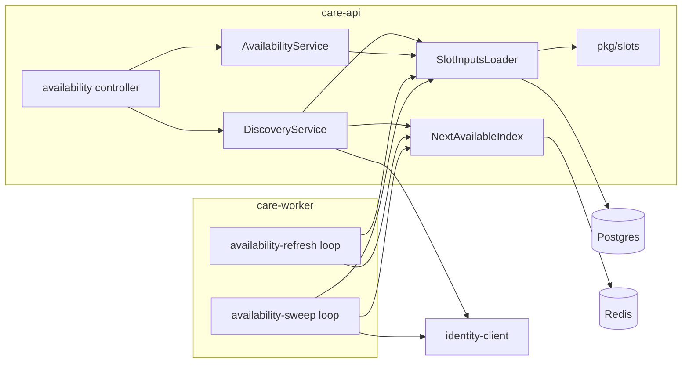

# Availability — Doctor Discovery and Slots

Design of the `availability` module: `GET /api/doctors`, `GET /api/doctors/{doctorUserId}` and
`GET /api/doctors/{doctorUserId}/slots`. Decided in `/system-design` on 2026-10-21.

> **Build status (2026-10-23).** Slices 1 and 2 are built. Slice 1 (2026-10-21): `GET /api/doctors/{doctorUserId}/slots`, the
> `slots:` cache with `slots-ver`, the real after-commit invalidation (`AvailabilityChangeListener` bound to the schedule,
> consultation and doctor change ports), `SLOT_CACHE_TTL_SECONDS`. Slice 2 (2026-10-23): `GET /api/doctors` and
> `GET /api/doctors/{doctorUserId}`, the rank index `next-available:index`, `free-map:*`, the `availability-refresh` and
> `availability-sweep` worker loops (the worker now holds its own Redis connection), Redis-down degradation, and migration
> `20261021120000` (three discovery indexes). **Slice 3 is not built:** the `name-index` and the index-backed `name` filter (until then
> `name` matches headlines only and every response with `name` carries `meta.degraded: ["nameFilter"]`). As-built detail and
> deviations: [availability spec](../availability/spec.md) section 14. The slot algorithm and booking
re-validation are in [scheduling-slots.md](./scheduling-slots.md); this page is the discovery layer on top of them.
The API source of truth stays `contracts/openapi.yaml`. Scope: service. Platform inputs (traffic, Identity load) are in the
hub (`../vcare-hub/architecture/capacity.md`); the derivation is in [capacity.md](./capacity.md).

## Forces
- PRD 7.4 and 7.5: search by specialty, name, language, price, availability window; sort by earliest availability, price,
  experience; slots shown in the patient's timezone.
- Budgets (p95): search < 400 ms, 14-day slot computation < 300 ms. Load: search and slots each ≈ 300 k/day, ≈ 25 rps peak.
- Slots are never stored ([ADR 0002](../adr/0002-slots-never-stored.md)); only Redis caches of derived data are allowed.
- Redis is Tier 2 ([ADR 0006](../adr/0006-health-split-redis-tier-2.md)); a Case 2 Identity outage never produces a 5xx.

## Decisions
| # | Decision | ADR |
|---|---|---|
| D1 | Earliest-availability ranking is a Redis sorted set `next-available:index`; the whole filtered candidate set is ranked from it | [0024](../adr/0024-next-available-rank-index-free-map-and-sweep.md) |
| D2 | Freshness: `ZREM` on input change, worker refresh, 120 s sweep, reader treats absent or past-score as a miss | 0024 |
| D3 | `availableFrom/To` is answered exactly (15-minute buckets) from a per-doctor `free-map` bitmap | 0024 |
| D4 | The name filter uses a TTL-bound `name-index` built by the sweep job from hydrated names | [0025](../adr/0025-derived-name-index.md) |
| D5 | Redis down: search degrades to price order and says so in `meta.degraded` | [0026](../adr/0026-discovery-degradation-when-redis-is-down.md) |

## Components

- **Module `availability`** (no tables): controller, `DiscoveryService` (search, profile), `AvailabilityService` (slots,
  preview), `SlotInputsLoader` (hours, exceptions, types, busy consultations for many doctors with `= ANY($1)`: a fixed
  4 queries per batch, run one after the other so a batch holds one pool connection), `NextAvailableIndex` (the Redis access), the two listeners below and the worker loops.
- **`pkg/slots` gains pure functions** (no clock, no I/O) that reuse the grid rules of `slot-fit.ts`, so the slot list,
  the free-map and booking re-validation cannot disagree: `subtractBusy`, `sliceSlots`, `firstFreeStart`, `toFreeMap`,
  `testFreeMap`.
- **Routing:** `/doctors/me/*` stays in `doctors` and `schedules`; the availability router is mounted so `me` is matched
  before the numeric `{doctorUserId}`.

## Redis keys (all derived; nothing here is a source of truth)
| Key | Holds | Lifetime |
|---|---|---|
| `next-available:index` (ZSET) | member = doctor user id; score = epoch ms of the earliest free slot start in the next 14 days for the doctor's **shortest active type**; sentinel `1e15` = known "none" | member removed on input change; rewritten by refresh and sweep |
| `free-map:<doctorUserId>` | base instant + 14 days × 96 bits (≈ 170 B), one bit per 15-minute bucket that contains a free slot start | TTL 600 s; deleted on input change |
| `next-available:refresh` (SET) | doctors to recompute | drained by the worker; lost on Redis loss (the sweep covers it) |
| `next-available:swept-at` | timestamp of the last finished sweep | alerting |
| `name-index` (ZSET, lex), **slice 3, not built** | `<lowercased display name>\0<userId>` | rebuilt atomically every 300 s, TTL 15 min |
| `slots:<doctorUserId>:<ver>:<typeId>:<fromDate>:<toDate>` | UTC slot list (viewer rendering happens after the cache); dates are doctor-local | TTL 60 s |
| `slots-ver:<doctorUserId>` | integer bumped on any input change | none |

The `<ver>` segment replaces prefix deletion (no `SCAN`): a change bumps the version, old entries stop being read and expire.

## Search flow — `GET /api/doctors`
1. **Candidates (Postgres, one query).** Bookable doctors (Domain rule 6: approved, synced, not suspended, accepting, at
   least one active type) passing the SQL filters: specialty slug, language, fee range, headline prefix. Returns id, fee,
   years. Backed by a partial index on the bookable predicate (migration with the module; each index commented with this
   query).
2. **Name filter.** `ZRANGEBYLEX` prefix on `name-index`, unioned with the SQL headline match, intersected with the candidates.
3. **Rank.** `ZMSCORE` over the candidates. A **miss** is an absent member or a score before `now`; misses are computed
   inline (`SlotInputsLoader` batch + `pkg/slots`), at most `AVAILABILITY_INLINE_MISS_CAP` (default 20) per request,
   single-flighted per doctor, and written back. Doctors still unknown rank last.
4. **Window filter.** Only when `availableFrom` / `availableTo` is present: pipelined `GET free-map:<id>` for the surviving
   candidates; keep a doctor when a bit is set in a bucket overlapping `[from, to)`.
5. **Order and page.** Sort `(score, id)`; the cursor is the signed `(score | none, id)`; fetch `limit + 1`. With
   `sort=price` or `sort=experience` and no window filter, steps 2 to 5 are replaced by a plain SQL keyset on
   `(consultationFee, id)` or `(yearsExperience, id)`, and `ZMSCORE` is read for the page rows only.
6. **Hydrate** the page with one batched Case 2 call (degrade rules unchanged: `profileHydrated:false`, never a 5xx).

Window rules: `availableFrom` / `availableTo` must lie inside `[now, now + 14 days]` and span at most 14 days; a missing
`from` means `now`, a missing `to` means `from + 14 days`; anything else is `400 ValidationFailed`.

## Profile and slots
- `GET /api/doctors/{doctorUserId}`: a patient gets `404` for a non-bookable doctor; an admin sees any doctor with
  `status: bookable | not_bookable`. Returns `nextAvailableAt` and `nextAvailableSlots` (first 5 slots of the shortest active
  type, rendered in `timezone`, else the caller's patient profile zone, else UTC).
- `GET /api/doctors/{doctorUserId}/slots`: `slots:` cache hit, else the fixed 5 queries of the query plan in
  [scheduling-slots.md](./scheduling-slots.md) and the in-memory compute; window ≤ 14 days, clipped to `[now, now + 60 days]`.

## Invalidation (after commit, never fails the write)
| Source | Port | Today |
|---|---|---|
| hours, exceptions, types | `ScheduleChangeListener` (`schedules`) | **bound** (slice 1) to `AvailabilityChangeListener`; the no-op default stays for unit tests |
| book, reschedule, cancel, no-show, complete | `ConsultationChangeListener` (`consultations`) | **bound** (slice 1), as above |
| timezone change, accepting toggle, suspension, reinstatement | `DoctorChangeListener` port in `doctors` (`DoctorsService.notifyDoctorChanged`), fired also by `admin-doctors` | **added and bound** (slice 1), as above |

As built, the one invalidation is a single Redis `MULTI` (`INCR slots-ver`, `EXPIRE` 7 days, `ZREM next-available:index`,
`DEL free-map`, `SADD next-available:refresh`). Since slice 2 the index and the free-map are written (version-guarded, see below) and
`availability-refresh` drains the refresh set. A Redis failure logs `availability_listener_skipped` (warn, throttled to once a
minute); a listener rejection is also swallowed by the listener and logged by the caller (`doctor_change_listener_failed`,
`schedule_change_listener_failed`, `consultation_change_listener_failed`). The write is never affected.

Every event does the same four things: bump `slots-ver`, `ZREM` the member, delete the `free-map`, `SADD` the refresh set.
Only the timezone change is needed for correctness: the other doctor events are already excluded by the SQL candidate
query and only keep the index tidy. A doctor who becomes bookable simply appears as a miss and is computed on demand.

## Worker loops (`care-worker`, [ADR 0008](../adr/0008-care-worker-component.md))
Both loops are **built** (slice 2) and registered in `worker-loops.ts`; each runs once with `node dist/worker.js --once <loop>` (exit 1 when the sweep lock is held, Redis is unreachable, a batch could not be written, or the doctor list was truncated).

| Loop | Cadence | Work |
|---|---|---|
| `availability-refresh` | every 2 s | `SPOP` up to 50 doctors (at most 10 batches per tick) from the refresh set, recompute (5 queries per batch), write index and free-map version-guarded; failed ids go back into the set; every 30 s emits the queue-depth and sweep-age gauges |
| `availability-sweep` | every `AVAILABILITY_SWEEP_INTERVAL_SECONDS` (120 s), once at boot after the worker's Redis connect (waits up to 3 s); singleton by session advisory lock (namespace 1104) | recompute every bookable doctor in batches of 100, drop members that are no longer bookable (re-checked against Postgres first), write `swept-at`. **Slice 3:** every `AVAILABILITY_NAME_REFRESH_SECONDS` (300 s) also rebuild `name-index` |

The guarded write is a Lua script compared on `slots-ver` (a computation that started before an invalidation cannot write a stale score after the `ZREM`). The worker owns its own Redis client and passes it to the loops and to its `IdentityClient`.

## Failure handling
| What fails | Behaviour | Bound |
|---|---|---|
| Redis down or breaker open | Search degrades per [ADR 0026](../adr/0026-discovery-degradation-when-redis-is-down.md); `/slots` computes from Postgres; version bump skipped and logged | booking re-validates every time |
| Worker down | ordering quality drops (more unknowns ranked last); correctness holds because a change removes the member | alert `AvailabilitySweepStale` |
| Identity down | Case 2 degrade as today; `name-index` keeps its last build until its TTL, then headline-only (`meta.degraded: ["nameFilter"]`) | never a 5xx |
| Listener failure after commit | the write is unaffected | index staleness ≤ one sweep (≈ 2 min); slot list ≤ 60 s |
| Redis flush or cold start | the worker sweeps at boot; until then up to 20 inline computes per search, the rest rank last | ≈ 2 min of poorer ordering |
| Hot doctor stampede | single-flight per doctor, in-process | |

## Security and privacy
Roles patient and admin, ownership none, `authorize(policy)` on every route; no clinical data and therefore no audit rows.
Patients cannot see a non-bookable doctor (`404`); the public DTO omits suspension and sync state. Rate limits: 60/min per
IP and 120/min per user. `timezone` is validated with luxon; the cursor is the existing signed cursor. Names in
`name-index` live only in Redis for at most 15 minutes, are never logged and never reach Postgres.

## Budgets, capacity and observability
- Search steady state: 1 candidate or page query plus 5 page-view queries (profiles, languages, specialty links, specialties, active types), 1 `ZMSCORE`, optionally one pipelined `free-map` pass, 1 batched hydration. An index miss adds an inline batch of 5 queries (at most `AVAILABILITY_INLINE_MISS_CAP` doctors).
- Measured on the dev machine at 2,500 bookable doctors (2026-10-23): search p95 12 to 48 ms warm, 68 to 97 ms with a cold index, `/slots` 14 / 7 ms (miss / hit); a full sweep takes 6.4 to 6.7 s. The planning figure for the 0.5 vCPU worker is about 15 to 20 s of CPU per 120 s (≈ 15 % of the worker); derivation, Redis
  size and the 10× check are in [capacity.md](./capacity.md).
- Metrics (log-derived, [ADR 0007](../adr/0007-log-derived-metrics.md)): `availability_index_miss`,
  `availability_inline_compute_ms`, `availability_degraded{reason}`, `availability_sweep_duration_ms`,
  `availability_sweep_age_s`, `availability_refresh_queue_depth`. Alerts (tickets, Redis is Tier 2):
  `AvailabilitySweepStale` (`swept-at` older than 10 min), `AvailabilityDegradedHigh` (more than 5 % of searches degraded for 5 min).

## Build slices
1. **Built 2026-10-21.** `pkg/slots` pure functions, `SlotInputsLoader`, `/slots`, the slots cache with `slots-ver`, the two real listeners and
   the `doctors` port. Useful alone.
2. **Built 2026-10-23.** The index, free-map, refresh and sweep loops, search and the profile preview, plus the partial bookable-candidate
   index migration.
3. **Planned.** `name-index` and the name filter.

## Contract changes (provider: care-service; no Identity change)
Slice 1 applied the slots part (C1 to C3: 404 for a non-bookable doctor or a foreign/inactive type, window clipping, IANA validation). Slice 2 applied items 1 to 4 and 6 below plus the wording of item 5 (the `NameFilter` text already describes the headline-only fallback); slice 3 only makes the index-backed match available.
1. `searchDoctors` `meta.degraded`: optional array of `sort | availabilityFilter | nameFilter`.
2. `AvailableFrom` / `AvailableTo`: window inside `[now, now + 14 d]`, at most 14 days, defaults, 15-minute granularity,
   `400` outside.
3. `DoctorProfile.nextAvailableAt`: earliest free start of the shortest active type within 14 days; `null` when none or unknown.
4. `nextAvailableSlots`: first 5 slots of the shortest active type (not "first active type").
5. `NameFilter`: prefix on display name through the derived index, headline-only fallback.
6. A cursor whose sort kind no longer matches (issued in degraded mode) is `400 ValidationFailed`.
New env vars (declared in `lib/config/env.ts`, documented in [infrastructure.md](./infrastructure.md)): `AVAILABILITY_SWEEP_INTERVAL_SECONDS` (120),
`AVAILABILITY_NAME_REFRESH_SECONDS` (300; declared in slice 2, used from slice 3), `AVAILABILITY_INLINE_MISS_CAP` (20). The earlier planned `NEXT_AVAILABLE_CACHE_TTL_SECONDS` and `RATE_LIMIT_SEARCH_*` variables do not exist (the per-route limiter constants live in `availability/constants.ts`).

## Accepted trade-offs
- A page of the earliest sort can skip or repeat a doctor whose value changes between page requests.
- The index reflects the shortest active type only; the exact per-type answer is `/slots`.
- Window filters are exact to 15 minutes; `/slots` and booking are exact to the minute.

## Open follow-ups
- Decided in the spec and built: the sweep lock namespace (1104, id 0), the `free-map` layout (173 bytes: version, base bucket, 168 bytes of bits) and the three discovery indexes.
- Known limitations carried by the as-built design: with a window filter the order is by the doctor's overall earliest start, not the earliest start inside the window; fee filters ignore currency; a Redis-down page or a mid-request index failure invalidates an `earliest` cursor (`400`, restart the list).
- Revisit triggers (also in [capacity.md](./capacity.md)): bookable doctors above 6 k, sweep above 60 s, search p95 above 300 ms.
