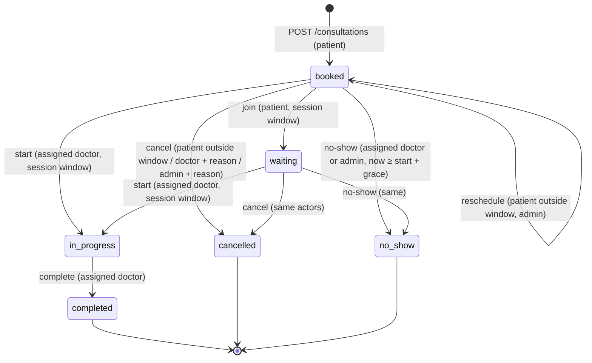
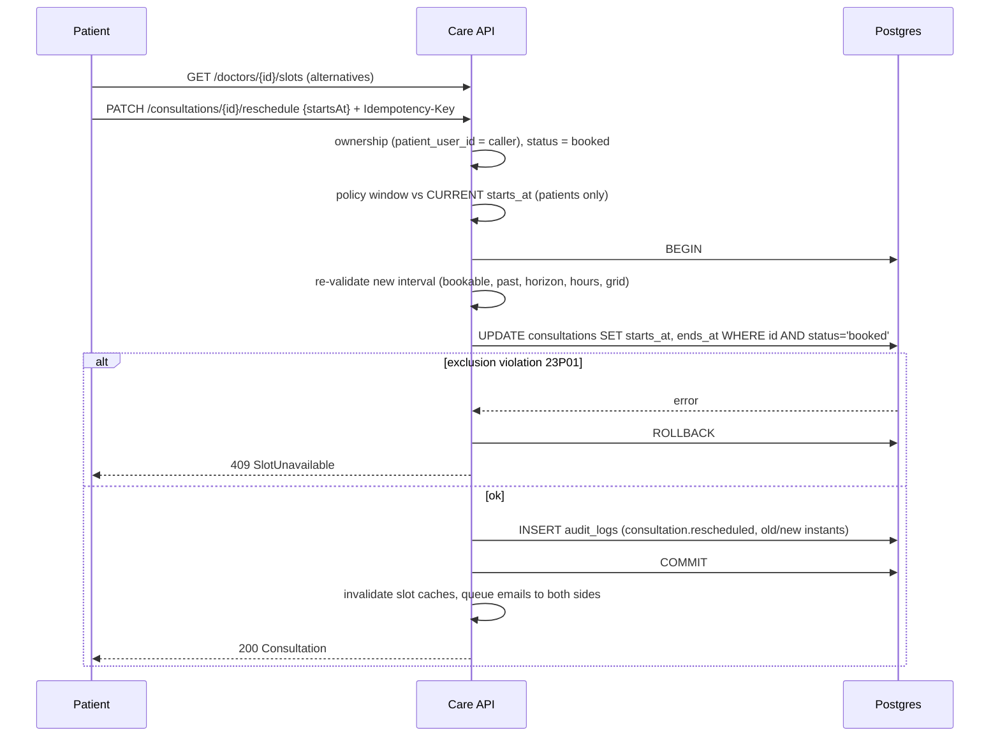
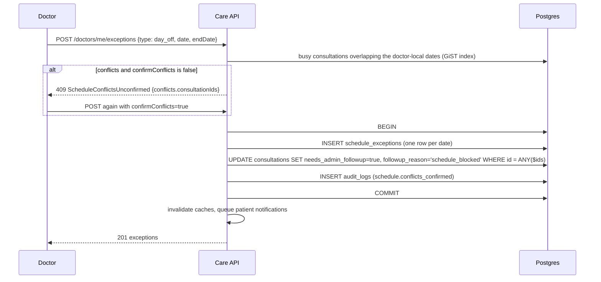

# Consultation Lifecycle

`booked → waiting → in_progress → completed`, with `cancelled` and `no_show` as terminal exits
(CLAUDE.md → Domain rules, Lifecycle).

## State diagram

## Transition table
| Transition | Route | Actor | Condition | Error on violation |
|---|---|---|---|---|
| create → `booked` | `POST /consultations` | patient (active, email verified) | Domain rules 1–8 | see [scheduling-slots.md](./scheduling-slots.md) |
| `booked → waiting` | `PATCH /:id/join` | patient | inside session window | 409 `RoomNotOpen`/`InvalidTransition`, 503 `VideoUnavailable` |
| `booked/waiting → in_progress` | `PATCH /:id/start` | assigned doctor | inside session window, doctor not suspended | 409 `RoomNotOpen`/`InvalidTransition`, 403 `Forbidden`, 503 `VideoUnavailable` |
| `in_progress → completed` | `PATCH /:id/complete` | assigned doctor | — | 409 `InvalidTransition` |
| `booked/waiting → cancelled` | `PATCH /:id/cancel` | patient (outside policy window), assigned doctor (reason), admin (reason, any time) | not terminal | 409 `PolicyWindowViolation` / `InvalidTransition`, 400 missing reason |
| `booked/waiting → no_show` | `PATCH /:id/no-show` | assigned doctor or admin | now ≥ `starts_at` + grace | 409 `NoShowTooEarly` |
| reschedule (status stays `booked`) | `PATCH /:id/reschedule` | patient (outside policy window), admin (reason) | new slot passes rules 1–5; old interval released in the same transaction | 409 / 422 booking codes |

- **Terminal states never change** (Domain rule 9): every update is `… WHERE id=$1 AND status = ANY($from)`;
  zero rows → `409 InvalidTransition`.
- Any participant re-joining (`/join` on `waiting` or `in_progress`), and a doctor calling `/join` on `booked`, receives a fresh video token with no transition and no audit row (the doctor's transition is `/start`).
- Every status change writes an audit row (`consultation.<to_status>`) in the same transaction and invalidates the
  doctor's slot and next-available caches after commit (terminal exits free the interval).
- Suspended doctors (`suspended_at IS NOT NULL`) cannot start, complete, cancel, or mark no-show — checked
  locally, not only at token expiry.

## Time windows
| Window | Default | Env | Rule |
|---|---|---|---|
| Policy window | 120 min before `starts_at` | `CANCELLATION_POLICY_MINUTES=120` | patients cannot cancel or reschedule inside it (measured against the **current** start); admins can |
| No-show grace | 10 min after `starts_at` | `NO_SHOW_GRACE_MINUTES=10` | `no_show` only when now ≥ start + grace |
| Session window | half-open `[starts_at − 10 min, ends_at + 15 min)` (`opensAt <= now < closesAt`) | `WAITING_ROOM_OPEN_MINUTES=10`, `SESSION_OVERRUN_MINUTES=15` | join/start only inside it (a terminal row answers `InvalidTransition` before `RoomNotOpen`); video tokens issued only inside it, expiring at `min(now + VIDEO_JOIN_TOKEN_TTL_SECONDS, closesAt)`; `complete` has no window check |

All comparisons are on UTC instants.

## As built (consultations module, 2026-10-12)
Built: create → `booked`, reschedule, cancel, list, get-one ([spec](../consultations/spec.md)). `join`, `start`, `complete`, `no-show`, `waiting-room`,
`calendar` and the video port are the `sessions` unit (built 2026-10-15, section below); `applyTransition` (`WHERE id AND status = ANY($from) AND deleted_at IS NULL`, zero rows → `409 InvalidTransition`)
is generic so `sessions` reuses it.
- **Booking** is one transaction: replay lookup by `(patient_user_id, idempotency_key)` → `FOR SHARE` on the doctor profile (serializes with suspension and schedule
  writes) → bookable, type, past, horizon, grid check (`isSlotOnGrid`, see [scheduling-slots.md](./scheduling-slots.md)) → insert → two `booking_confirmed` outbox rows → audit.
  `23P01` → `409 SlotUnavailable`; `uq_consultations_idempotency` is the Redis-loss fallback (same `request_hash` replays, else `422 IdempotencyConflict`).
- **Reschedule** only from `booked`; the patient window is `CANCELLATION_POLICY_MINUTES` (exactly 120:00 before start is allowed, a start already past is a violation); an
  admin needs a `reason`; the new start equal to the current is a `200` no-op (no write, audit or outbox); a non-bookable doctor blocks it (decision D-R2, including
  `is_accepting_patients=false`; cancel stays available); the stored interval length is kept; the reminder marks and the follow-up flag are cleared.
- **Cancel** from `booked`/`waiting`; assigned doctor and admin need a `reason`; a locally suspended doctor gets `403`. A retry with a new key after the first success is
  `409 InvalidTransition` (cancel's idempotency is Redis-only).
- Every write enqueues `notification_outbox` rows in its transaction (`rescheduled`, `cancelled` to both parties); delivery is the `notifications` unit (built 2026-10-12: `care-worker` claims, looks up contacts and sends through the log-only email port; the 24 h and 1 h reminders for patient and doctor come from a 1-minute scan of `booked` consultations, dropped at claim time if the consultation was cancelled, rescheduled or has started; a reschedule resets both reminder stamps; suspension also queues a neutral `doctor_suspended` notice to each affected patient, once per flag; a delayed `rescheduled` notice is dropped at claim time if the consultation is now terminal or moved again, a delayed `doctor_suspended` notice if it is now terminal, `cancelled` is always sent, and a patient whose consultation is `in_progress` gets an in-progress wording; spec N-D14). Slot and `next-available`
  cache invalidation goes through the `ConsultationChangeListener` seam after commit, a no-op until discovery fills it; a listener failure is logged without data, never thrown.
- **List scopes** (decision D-R8): `upcoming` = `endsAt > now`, `past` = `endsAt <= now`, `all` ascending; an `in_progress` row past its `endsAt` matches neither scope; `sessions` (2026-10-15) left this unchanged and adds no exit for a stale `in_progress` row (follow-up).
- **Follow-up flags** (`needs_admin_followup`) are set by the filled ports for future `booked`/`waiting`/`in_progress` rows: `schedule_blocked` (only rows not already flagged with that
  reason, so the patient is notified once; the `409` body still lists every stranded id) and `doctor_suspended` (all rows). Nothing is auto-cancelled; reschedule clears the flag, cancel ends the row.

## Session (waiting room and video) — as built 2026-10-15 ([sessions spec](../sessions/spec.md))
1. The patient calls `/join` inside the window: `booked → waiting`, `joined_at` set, audit `consultation.waiting`. The room is created at the provider **before** the transaction (`ensureRoom`, idempotent per consultation, 2 s bound) and persisted in `room_id` (first value wins); the join token is issued **after** commit, bound to this participant's room, user and role.
2. The doctor polls `GET /consultations/waiting-room` (own `booked`/`waiting` rows whose window is open, at most 100) and `GET /consultations/calendar` (`[from, to)`, at most 7 days, every status plus schedule exceptions). Neither returns `complaintText`; patients are hydrated through Case 2 (degrade).
3. The doctor calls `/start`: `→ in_progress`, `started_at` set, audit `consultation.started` and one `doctor_joined` outbox row for the patient in the same transaction; the doctor's token follows the commit.
4. The doctor calls `/complete` (only from `in_progress`, no window check): `→ completed`, `completed_at` set. The record can now be written ([clinical-records.md](./clinical-records.md)).
5. `no-show` (assigned doctor or admin, from `booked`/`waiting`, once `now >= starts_at + grace`): `→ no_show`, audit `consultation.no_show` with `noteLength` only (the optional note is not stored); the change listener frees the interval.

**Provider failure.** No provider call is inside a transaction. Failure before commit: `503 VideoUnavailable`, state unchanged. Failure after commit (token issue): `503`, the state is already valid (`waiting`/`in_progress`) and repeating `join` returns a token. Check order: not found / not participant `404` → status `InvalidTransition` → window `RoomNotOpen` / grace `NoShowTooEarly`.

## Flow D — Reschedule

The same row is updated, so the old interval is released atomically when the new one is claimed. Admins follow
the same path without the policy window and with a required `reason` (audited as admin-action).

## Flow E — Cancellation
Patient outside the window, doctor with a reason, or admin at any time with a reason:
`BEGIN → UPDATE status='cancelled', cancelled_at, cancelled_by, cancelled_by_user_id, cancel_reason
WHERE status IN ('booked','waiting') → audit → COMMIT → invalidate caches → notify both parties (async)`.
The exclusion constraint's predicate no longer covers the row, so the slot is immediately bookable again.
Cancellation is idempotent on `Idempotency-Key`; a second cancel with a new key returns `409 InvalidTransition`.

## Flow F — Doctor takes leave

Consultations are **never auto-cancelled**. Admins work the follow-up queue
(`GET /consultations?needsAdminFollowup=true`) and reschedule or cancel on behalf. Working-hours replacement follows
the same conflict protocol.

## Flow G — Suspension (summary)
Case 3 flags every future non-terminal consultation `needs_admin_followup=true`
(`followup_reason='doctor_suspended'`) and blocks all doctor actions and new bookings from commit time. See
[integration.md](./integration.md).
