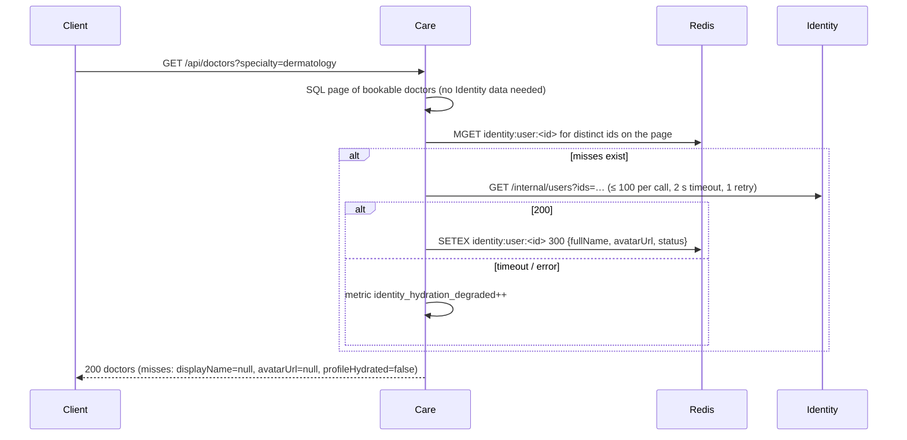

# Cross-Service Integration (Care → Identity)

Care is the **consumer** in all three platform integration cases. All calls go through `lib/identity-client`.
Implementation guidance: the **`cross-service-integration`** skill. The case definitions and failure policies are
platform-scope and authored in `../vcare-hub/architecture/landscape.md` (hub ADR 0008); this shard is Care's consumer
implementation of them (client, sync jobs, alerts) — when the two disagree, fix the hub first via `/system-design`.
Identity's contract (synced): `../vcare-hub/contracts/identity-service.openapi.yaml`.

| Local endpoint | Identity | Port |
|---|---|---|
| JWKS | `GET http://localhost:3000/.well-known/jwks.json` | public listener |
| Token, users, status | `http://localhost:3100/internal/*` | internal listener |

## User-token verification (no call per request)
Identity signs EdDSA access tokens (15 min). Care verifies them locally (`lib/auth`, built 2026-10-02) against the
JWKS cached in memory: re-fetched every 5 minutes (Identity's `max-age`), and on an unknown `kid` at most once per
minute; while refreshes fail the cached keys stay trusted for at most 1 hour after the last successful fetch, then
none are. It requires `iss=vcare-identity`, `aud` ∋ `vcare-care`, `typ=user`, `sub`/`exp`/`iat`/`jti`, and
well-formed `role`/`status`/`ev` (30 s clock tolerance). If the JWKS cannot be fetched and no cached key matches →
`401 Unauthorized`; an expired token → `401 TokenExpired`; verification is never skipped. The JWKS read is not one of
the integration cases and does not go through `lib/identity-client`; it forwards `X-Request-Id` like every call to
Identity. Readiness reports the cache as `checks.identityJwks` (informational).

## Service-token flow

```mermaid
sequenceDiagram
    participant IC as Care lib/identity-client
    participant ID as Identity :3100
    Note over IC: cache empty or now >= exp - 30s
    IC->>ID: POST /internal/auth/token<br/>grant_type=client_credentials, client_id, client_secret,<br/>scope="users:read users:status:write", audience=vcare-identity
    ID-->>IC: { access_token (typ=service, 300 s), token_type: Bearer, expires_in: 300 }
    Note over IC: cache; concurrent refreshes single-flighted
    IC->>ID: GET /internal/users?ids=… (Authorization: Bearer service token, X-Request-Id)
    alt 401
        ID-->>IC: 401
        IC->>ID: fetch a new token once, retry the call once
    end
```
The acting admin travels as data (`actorUserId`) for Identity's audit trail; it never grants authorization.
`SERVICE_CLIENT_SECRET` has no default and is never logged.

**Inbound:** `GET /internal/doctors/{userId}/summary` on Care's internal listener requires `typ=service`,
`aud` ∋ `vcare-care`, scope `doctors:read`. No MVP service client holds `doctors:read`; the endpoint serves admin
tooling and the Phase-2 AI service once a client is provisioned in Identity.

## Case 1 — Verification unlocks the account (retry, report pending)
Triggers: `PATCH /admin/applications/:id/approve` (→ `active`), `/reject` (→ `rejected`), `/reopen` and a doctor's
resubmission `rejected → submitted` (→ `pending`).

```mermaid
sequenceDiagram
    participant A as Admin
    participant C as Care
    participant DB as Care DB
    participant ID as Identity
    A->>C: PATCH /admin/applications/12/approve
    C->>DB: BEGIN; verification_status='approved', reviewed_by, review_note, decided_at,<br/>identity_sync_status='pending';<br/>INSERT identity_sync_jobs (kind=verification, status=pending); audit verification.approved; COMMIT
    loop up to 3 attempts, 2 s timeout, backoff 200 ms·2^n ±20%
        C->>ID: PATCH /internal/users/204/status {status: active, reason, actorUserId}
    end
    alt 200
        C->>DB: identity_sync_status='synced'
        C-->>A: 200 application
    else transient failures exhausted
        C->>DB: job stays pending; next_attempt_at = now + backoff
        C-->>A: 202 { identitySync: "pending" }
        Note over C: background retrier continues; alert IdentityApprovalSyncPending after 15 min
    else 409 InvalidStatusTransition (non-retryable)
        C->>DB: identity_sync_status='failed'; job status='failed'
        C-->>A: 202 { identitySync: "failed" }
        Note over C: alert IdentitySyncTransitionRejected; admin console shows it
    end
```
- The decision is **kept** in every branch; Identity owns the account state, Care owns the medical judgment.
- The doctor is **not bookable** until `verification_status='approved'` **and** `identity_sync_status='synced'`.
- Identity's status PATCH is idempotent, so blind retries are safe.
- **As built (verification, 2026-10-08):** the `identity_sync_jobs` row is inserted in the decision transaction, so there is no crash window and no sweeper for Case 1. One open job per doctor (a newer decision supersedes it). Inline and worker attempts for one doctor serialize on a session-scoped per-doctor advisory lock and re-check that the job is still the current pending one; a stale job is marked `superseded` and never sent. The worker (`identity-sync` loop, `--once identity-sync`) reads due jobs without `SKIP LOCKED` and makes one attempt per job per tick, honouring `next_attempt_at` inside the lock. Approve/reject answer `409 Conflict` + `Retry-After: 5` while `identity_sync_status='pending'` (an unapplied resubmit/reopen), because superseding that job would send Identity `rejected -> active`, which it refuses. Worker retries build no response view, so they make no Case-2 call.
- **Known environment dependency:** real Identity does not yet serve `GET /internal/users` or `PATCH /internal/users/{id}/status` (its internal-users module is pending). Until it lands, Case 1 against real Identity keeps the decision, answers `202 identitySync: pending`, and the worker retries on `404`; Case 2 degrades to `profileHydrated: false`. Care needs no change when it lands.

## Case 2 — Batch profile hydration (degrade, never fail)
Used by search, doctor profile, consultation lists, waiting room, calendar, the admin application queue. As built (`sessions`, 2026-10-15): waiting room and calendar make one batched call per response through `hydrateUsersOrEmpty` (`lib/identity-client/hydrate.ts`, shared with the consultation lists); an outage returns `profileHydrated:false`, never a 5xx. Session writes (join, start, complete, no-show) make no Identity call.


- One call per page (chunked at 100 ids), never per row.
- Mapping: Identity `fullName` → Care `displayName`; `avatarUrl` unchanged; `status` is used **only** to hide
  non-active doctors from search when the cached data is fresh — never for authorization.
- A Case-2 outage never produces a 5xx; booking never waits on hydration.
- **Cache pipeline (as built in `lib/identity-client`, hardened 2026-10-12):** one `MGET identity:user:<id>` for all distinct ids; a malformed cached value counts as a miss; only misses go to Identity (chunks of ≤ 100, one retry); a successful chunk is written back with **one pipelined `SETEX` round trip per chunk** (TTL 300 s), not one command per user; a Redis failure on either side is swallowed (Redis is Tier 2) and the call proceeds against Identity.
- **As built for consultations (2026-10-12):** `GET /api/consultations` and `GET /api/consultations/{id}` make one `getUsersBatch` call per page for the distinct counterpart ids (admin views hydrate both sides). A thrown hydration is caught and treated as degraded. Write responses (`POST`, reschedule, cancel) make **no** Identity call and return both participants as `{ userId, displayName: null, avatarUrl: null, profileHydrated: false }`.

## Case 3 — Suspension revokes sessions (must not degrade)

```mermaid
sequenceDiagram
    participant A as Admin
    participant C as Care
    participant DB as Care DB
    participant ID as Identity
    A->>C: PATCH /admin/doctors/204/suspend {reason}
    alt already suspended and synced
        C-->>A: 200 no-op (current state)
    else already suspended, sync pending or failed
        C-->>A: 503 IdentityUnavailable (no-op re-report, same body)
    else not approved + synced
        C-->>A: 409 InvalidTransition
    end
    C->>DB: BEGIN; suspended_at, suspension_reason, identity_sync_status='pending';<br/>flag future booked/waiting/in_progress consultations needs_admin_followup (SuspensionImpactProvider);<br/>INSERT identity_sync_jobs (kind=suspension); audit doctor.suspended; COMMIT
    Note over C: from here no bookings and no doctor actions in Care
    loop inline attempts for ~6 s
        C->>ID: PATCH /internal/users/204/status {status: suspended, reason, actorUserId}
    end
    alt 200 (Identity revoked all refresh tokens in one transaction)
        C->>DB: identity_sync_status='synced'
        C-->>A: 200 SuspensionResult
    else transient failures
        C->>DB: job stays pending — retried forever by the identity-sync loop, backoff ≤ 60 s
        C-->>A: 503 IdentityUnavailable, suspension: "applied-locally, session-revocation-pending"
        Note over C: alert IdentitySuspensionSyncFailing (page) after 3 consecutive failures
    else 409 InvalidStatusTransition, or 400 / 403 / 422
        C->>DB: identity_sync_status='failed'; stop retrying; keep local suspension
        C-->>A: 503 IdentityUnavailable (data.identitySyncStatus=failed)
        Note over C: page on-call immediately (IdentitySyncTransitionRejected)
    end
```
- **Never report a suspension as complete before Identity confirms.** The admin UI must show that sessions are not
  yet revoked while the response is 503.
- "Until it succeeds" covers transient failures only (network, timeout, 404, 429, 5xx, one 401 token refresh, a malformed 200). An Identity `409 InvalidStatusTransition`, `400`, `403` or `422` is permanent (the request itself is refused): job and profile `failed`, page, no retry, local suspension kept.
- **As built (admin-doctors, 2026-10-09; [ADR 0021](../adr/0021-identity-sync-engine-module.md), [admin-doctors spec](../admin-doctors/spec.md)):** the `suspension` job row is inserted in the decision transaction (no sweeper, no crash window). The shared `identity-sync` engine serves all three kinds from one loop and lists suspension jobs first. A suspend on an already-suspended doctor answers `200` only when `identity_sync_status='synced'`, otherwise the same `503` (a blind retry never reads as confirmation). Suspend while a reinstatement is unsynced is `409 InvalidTransition`. The Identity-bound `reason` is clamped to 500 code points and never blank (`NotBlank` DTOs; the engine falls back to the job kind). The declared `503` is logged as `warn handled_error`, not `unhandled_error`. **Updated 2026-10-12:** the consultation flag is now real: `SuspensionImpactProvider` (bound by `consultations`) flags every future `booked`/`waiting`/`in_progress` row `doctor_suspended` (last writer wins on the reason) in the suspension transaction and never cancels or notifies.

## Case 4 — Reinstatement restores the account (retry, report pending)
[ADR 0012](../adr/0012-doctor-reinstatement.md), hub ADR 0009. **Provider change first:** Identity's internal status
route must accept `suspended → active`; it does for doctor targets (Identity ADR 0025). **Built 2026-10-09 (`admin-doctors`).**

```mermaid
sequenceDiagram
    participant A as Admin
    participant C as Care
    participant DB as Care DB
    participant ID as Identity
    A->>C: PATCH /admin/doctors/204/reinstate {reason}
    alt not suspended, no unsynced reinstatement
        C-->>A: 200 no-op
    else not suspended, latest reinstatement job pending or failed
        C-->>A: 202 { identitySync: "pending" or "failed" } (no-op re-report)
    else suspension not synced
        C-->>A: 409 InvalidTransition
    end
    C->>DB: BEGIN; suspended_at=NULL, suspension_reason=NULL, identity_sync_status='pending';<br/>INSERT identity_sync_jobs (kind=reinstatement); audit doctor.reinstated; COMMIT (follow-up flags stay)
    Note over C: doctor still unbookable (sync pending)
    loop up to 3 attempts, 2 s timeout, backoff
        C->>ID: PATCH /internal/users/204/status {status: active, reason, actorUserId}
    end
    alt 200
        C->>DB: identity_sync_status='synced'; invalidate caches
        C-->>A: 200
    else transient failures exhausted
        C->>DB: job stays pending (identity-sync loop retries)
        C-->>A: 202 { identitySync: "pending" }
        Note over C: alert IdentityReinstatementSyncPending after 15 min
    else 409 InvalidStatusTransition, or 400 / 403 / 422
        C->>DB: identity_sync_status='failed'
        C-->>A: 202 { identitySync: "failed" }
        Note over C: page (IdentitySyncTransitionRejected)
    end
```

The `202` carries `identitySync` as a top-level sibling of `data` (unlike Case 1). Reinstate never returns `503`.

## Notification contact lookup (Case 5; degrade by delay)
Hub ADR 0010, [ADR 0011](../adr/0011-notification-outbox-and-reminders.md). **Built 2026-10-12** (`notifications`; Identity provider: identity ADR 0024). Environment check: the `care-service` Identity client must hold `users:contact:read`.
`care-worker` calls `GET /internal/users/contacts?ids=` (≤ 100 ids, scope `users:contact:read`, granted only to
care-service) once per outbox batch (`IdentityClient.getContacts`, chunks of at most 100, one attempt per chunk, 2 s timeout, `X-Request-Id` forwarded). It uses a **second service-token cache** that asks for only `users:contact:read`; the status/hydration token (`users:read users:status:write`) is never merged with it. The response (email, locale, fullName) lives in worker memory for that batch
only — never cached in Redis, never stored, never logged (the logger redacts `email`). Every response is validated through DTOs; each entry is validated on its own: an invalid or duplicated entry makes only that id unavailable (its rows are delayed, neighbours are delivered), while an id that was not requested or an entry without a usable id makes the whole chunk malformed. Failure (network, timeout, 5xx, 429, 401 after one refresh, 403, 400, a token without the scope, malformed 200) → the chunk's outbox rows
stay `pending`, the attempt is not consumed, and the delay grows 30 s, 60 s, 120 s ... (cap 30 min) per consecutive failed **tick** (a batch whose lookup failed ends the tick, so one outage is one backoff step); users receive the email later. A failed chunk logs `notification_contacts_unavailable` (fixed error code, id count) and emits `identity_call_failed{case=contacts}`; a failure that retrying cannot fix without an operator (401 after the refresh, 403, a token without the scope) also logs `notification_contacts_forbidden` (error) and emits the counter of that name. Delayed rows have a future `next_attempt_at`, so `OutboxLagHigh` does not see them: the operator signals are `NotificationContactsForbidden` and `OutboxPendingStale` (`notification_outbox_oldest_pending_age_seconds`). Unknown or non-active ids → `skipped`. The API
listener never calls this endpoint and its service token never requests the scope.

## Failure policy table
| | Case 1 | Case 2 | Case 3 (Case 4 differs as noted) |
|---|---|---|---|
| Endpoint | `PATCH /internal/users/:id/status` → `active`/`rejected`/`pending` | `GET /internal/users?ids=` | `PATCH /internal/users/:id/status` → `suspended` |
| Criticality | required for the doctor to work | cosmetic | security-critical |
| Policy (`x-failure-policy`) | `retry-report-pending` | `degrade` | `must-not-degrade` |
| Local effect first | decision + `pending` committed | none | suspension + flags committed |
| Per-attempt timeout | 2 s | 2 s | 2 s |
| Inline attempts | 3 | 2 (1 retry) | 3 (~6 s worst case); Case 4: 3 |
| After inline failure | 202 `identitySync: pending`; durable job | cache or null fields; 200 | 503 `IdentityUnavailable`; durable job, no attempt cap |
| Non-retryable Identity answer (409, 400, 403, 422) | `failed`, alert, 202 `identitySync: failed` | n/a | `failed`, page immediately, 503 (Case 4: 202 `failed`, page) |
| Alert | after 15 min unsynced | degraded ratio | after 3 consecutive failures (page) |
| Gate | bookable only when approved **and** synced | — | "complete" only when confirmed |

Rationale and rejected alternatives: [ADR 0004](../adr/0004-cross-service-failure-policies.md).

## Doctor account status — Care is the only initiator
The former known gap (a doctor status change made directly in Identity not reaching Care) is **closed** by hub
ADR 0006 (`../vcare-hub/adr/0006-doctor-account-status-via-care-only.md`, 2026-09-15): Identity's
`PATCH /api/users/:id/status` refuses doctor targets with `403 Forbidden`, so every doctor account-status change
is requested by Care through Cases 1, 3 and 4, and `doctor_profiles.suspended_at` / `identity_sync_status` always move
with it. No Care contract change is required.

- Care still excludes non-active doctors from search using fresh Case 2 `status` as defence in depth.
- A `rejected` doctor can sign in and refresh at Identity (token `status=rejected`, identity-service ADR 0004), so
  the resubmission route (`rejected → submitted`, Identity `pending`) is reachable as designed.
- Reinstating a suspended doctor goes through Care as Case 4 (hub ADR 0009 amends ADR 0006); Identity's admin
  route still refuses doctor targets.

## Notifications
Booking confirmation, reminder, reschedule, cancellation, schedule-block, doctor-suspended, and "doctor joined" emails go through the
transactional outbox and `care-worker` ([ADR 0011](../adr/0011-notification-outbox-and-reminders.md)); they never
block or roll back the triggering write. Recipients are resolved through the contact lookup above.
